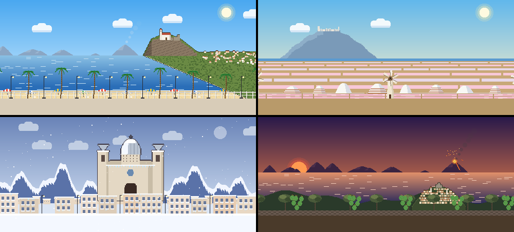
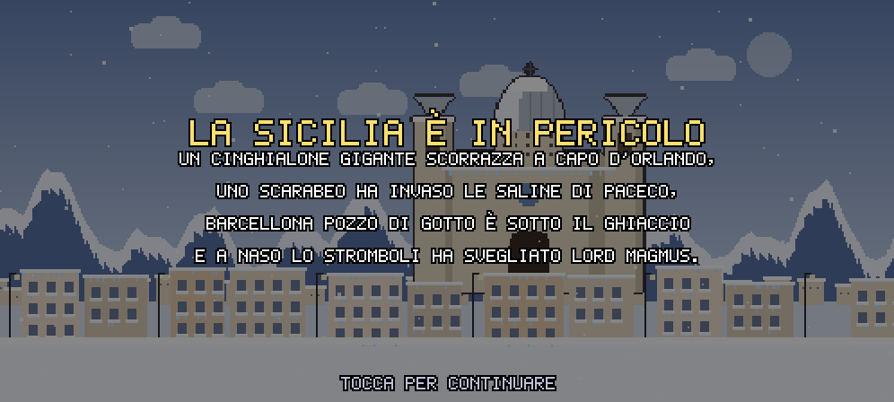
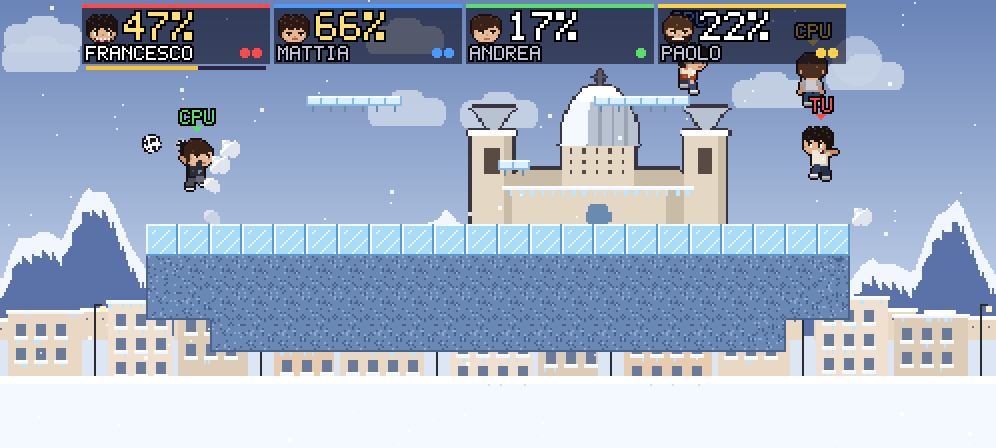
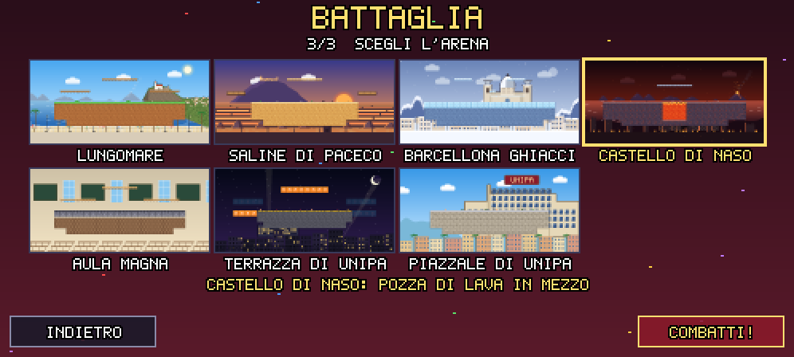
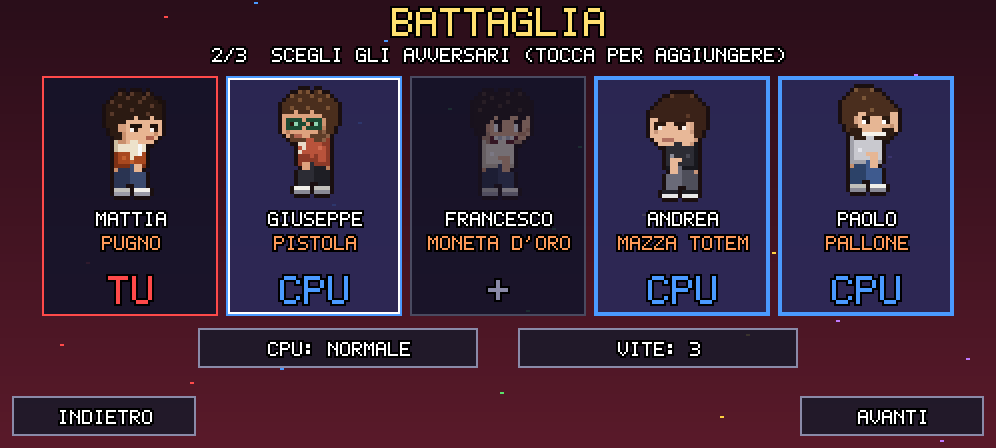
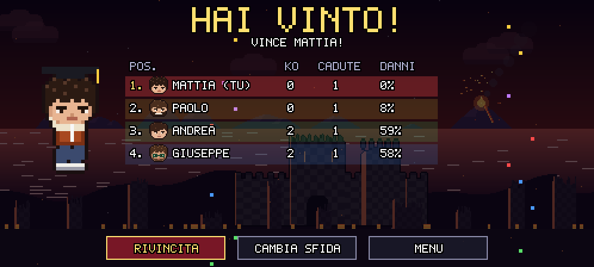
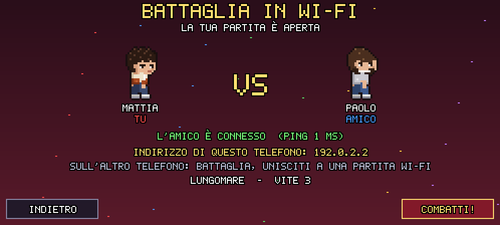
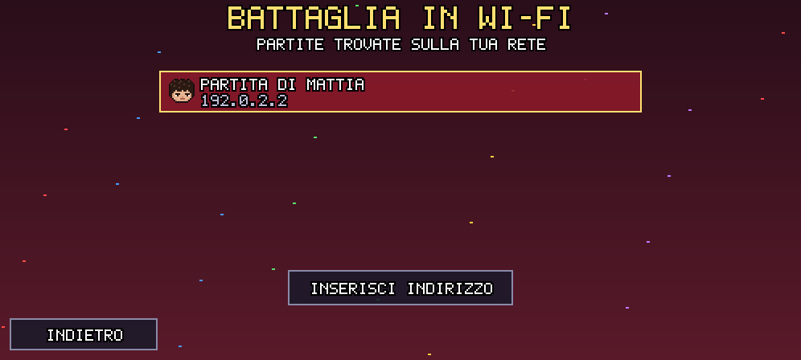

# Uniparty

**Uniparty** è un platform 2D in **pixel art** per **Android**, con mappa del mondo, **7 mondi, 34 livelli e 10 boss**.
È arrivata la lettera di ammissione all'Università di Palermo, ma prima c'è un **viaggio in quattro città siciliane**:
**Capo d'Orlando**, **Paceco**, **Barcellona Pozzo di Gotto** (finita sotto il ghiaccio) e **Naso**. Poi comincia il
**vero gioco**: 3 mondi all'**Università di Palermo (Unipa)**, dove ad aspettarti all'uscita c'è il **Prof. Giovanni Garbo**
di Teoria dei Segnali, che con i suoi segnali aleatori ha messo sottosopra la Sicilia.
C'è anche la **modalità battaglia**, in stile Smash Bros: scegli il tuo personaggio, i tuoi avversari e l'arena,
e ve le date con le stesse mosse della storia.
I protagonisti sono tutti e 5 i personaggi, disegnati in pixel art a partire dalle loro foto: **Mattia Battaglia**, **Giuseppe Mandanici**,
**Francesco Inzerillo**, **Andrea Sapienza** e **Paolo Zingales**.

**APK pronto da installare:** [`release/Uniparty.apk`](release/Uniparty.apk)

| | |
|---|---|
|  |  |
|  |  |
|  |  |
|  |  |
|  |  |

## Installazione
1. Copia `release/Uniparty.apk` sul telefono (o scaricalo da GitHub).
2. Aprilo e consenti l'installazione da "origini sconosciute" se Android lo chiede.
3. Richiede Android 7.0 o superiore. Il gioco è in orizzontale e a schermo intero.

L'APK è firmato con una chiave di debug (`keystore/pixelquest-debug.p12`): le build successive
fatte con `./build.sh` usano la stessa chiave, quindi si installano sopra la versione precedente.
Il gioco prima si chiamava "Pixel Quest": il pacchetto interno (`it.pixelquest.game`) è rimasto lo stesso, quindi
Uniparty si installa sopra la vecchia versione e i salvataggi restano.

## Comandi (touch)
| Comando | Azione |
|---|---|
| **Levetta** (metà sinistra dello schermo) | Cammina. **Spingila verso il bordo per correre** |
| oppure **Frecce ◀ ▶** (si sceglie nel menu) | Tieni premuto per camminare; dopo un attimo il personaggio corre da solo |
| **A** | Salta (tieni premuto per saltare più in alto) |
| **B** | Salto **spin** (distrugge anche i ricci spinosi e i proiettili) |
| **C** | Abilità del personaggio (oppure **calcia il guscio** di tartaruga che stai portando) |
| **★ SPECIALE** | Mossa speciale, quando la barra dell'energia è piena |
| ⏸ in alto a destra | Pausa |

Reattività dei comandi:
- **Tasti A/B/C:** tutta la parte destra dello schermo è divisa tra i tre tasti (vince il più vicino), quindi un tocco
  un po' fuori dal cerchio viene comunque preso. Anche un tocco brevissimo viene registrato e fa un salto vero.
- **Ogni dito nuovo è una pressione:** se il palmo o la base del pollice appoggiano sull'angolo dello schermo (che conta
  come A), la vera pressione su A fa saltare subito. Prima sembrava che A fosse già premuto e il salto partiva solo
  quando il contatto si staccava. La striscia più esterna del bordo destro e inferiore viene ignorata, perché lì
  appoggia la mano, e i tasti sono un po' più lontani dal bordo.
- **Levetta:** se tocchi il pad il personaggio parte subito. Se tocchi altrove a sinistra il pad si sposta sotto il dito.
  Il pad segue il dito, quindi per invertire la direzione basta un piccolo movimento.
- **Vibrazione:** una breve vibrazione conferma ogni pressione (si può disattivare). Non rallenta mai il tocco
  successivo, perché gira su un thread a parte.
- **Bordi dello schermo:** con la navigazione a gesti, Android tratteneva i tocchi vicino al bordo (il gesto "indietro")
  e il tasto A a volte arrivava in ritardo. Ora la parte bassa dei due bordi è esclusa dai gesti.
- **Pollice tra due tasti / tra le due frecce:** il tasto o la freccia tenuti restano quelli finché il dito non è
  chiaramente sull'altro, quindi niente salti interrotti né corsa che si azzera.

**Opzioni** (tasto B "MENU" sulla mappa, oppure ⏸ durante il livello): COMANDI levetta/frecce, VIBRAZIONE,
MUSICA, EFFETTI, cambio personaggio.

Combinazioni comuni a tutti i personaggi:
- **Corsa automatica**: levetta all'estremo (o freccia tenuta premuta).
- **Wall jump**: in aria, appoggiandoti a un muro ti attacchi automaticamente e scivoli; premi **A** per rimbalzare.
- **Triplo salto con capriola**: correndo, salta 3 volte di fila appena atterri; il terzo salto è una capriola altissima.
- **Rimbalzo sui nemici**: salta sulla testa dei nemici (tieni A/B per rimbalzare più in alto).
- Sono supportati anche tastiera e gamepad (frecce/WASD, Spazio/Z = A, X = B, C = C, Invio = pausa).

## Personaggi
| Personaggio | Abilità (C) | Mossa speciale (★) |
|---|---|---|
| **Mattia Battaglia**: ricci scuri, pile ruggine e crema | **Pugno**: stende i nemici, spacca i mattoni, respinge i proiettili | **Super pugno**: onda d'urto enorme davanti a lui (danno 5 a tutti, 4 ai boss) |
| **Giuseppe Mandanici**: occhiali verdi, barba, felpa terracotta | **Pistola**: 2 colpi ogni 10 secondi, danno 2 | **Scagnozzi**: due scagnozzi sparano ai nemici per 5,5 secondi |
| **Francesco Inzerillo**: ricci neri, apparecchio, maglia crema | **Moneta d'oro**: un'esplosione di **banconote taglienti** colpisce tutti i nemici vicini (circa 3 blocchi davanti e 2 dietro, 1 danno, distrugge anche i proiettili), poi una moneta rimbalza 3 volte e colpisce chi incontra (ogni 2,5 s) | **Tocco di Re Mida**: diventa d'oro con la corona e una fontana di monete colpisce tutto per 3 s; ogni nemico colpito dà una moneta |
| **Andrea Sapienza**: frangia scura, maglia nera | **Mazza totem** (nera, a forma di persona): swing ogni secondo che rispedisce indietro palle di cannone e proiettili e scaglia via i nemici, che diventano proiettili | **Totem di fuoco**: il totem gigante appare sopra di lui e lancia palle di fuoco per 4,5 s |
| **Paolo Zingales**: ciuffo, barba folta, maglia grigia | **Pallone**: calcio con 3 grandi rimbalzi, danno 2 (si ricarica in 2,5 s) | **Super tiro**: un pallone gigante va dritto e travolge nemici e mattoni (5 ai boss) |

Tutti hanno in comune corsa, salto variabile, spin, wall jump e triplo salto con capriola, e con l'abilità **C**
tutti possono rompere i mattoni davanti a sé (pugno, colpi di pistola, moneta, mazza, pallone): alcune gemme sono
murate dentro i mattoni. Il personaggio si sceglie
all'avvio e si cambia dalla mappa (tasto C "EROE" o dal menu).

### Energia e mosse speciali
La barra ★ in alto si riempie sconfiggendo nemici (+12, golem +25), raccogliendo monete (+1) e gemme (+20) e colpendo
i boss (+8). Quando è piena il tasto **SPECIALE** lampeggia. Morendo si conserva metà dell'energia.

### Power-up
Nei blocchi ci sono **fiori di fuoco** e **fiori di ghiaccio**. Come i cuori, escono dal blocco e camminano
(nella direzione in cui guarda il personaggio), quindi si prendono senza salire sul blocco:
- **Fuoco**: l'abilità diventa infuocata (+1 danno; il pugno e la mazza lanciano anche una palla di fuoco).
- **Ghiaccio**: l'abilità congela i nemici, che diventano blocchi di ghiaccio innocui da frantumare; i boss vengono rallentati.

Se vieni colpito perdi il fiore invece di un cuore. Ci sono anche cuori, stella dell'invincibilità e pozione vita extra.

### Negozio (potenziamenti con le monete)
Dalla mappa: **B MENU, poi POTENZIAMENTI**. Le monete restano tue e si spendono qui; ogni 100 monete raccolte ricevi
comunque una vita.
| | Livello 2 (120 monete) | Livello 3 (280 monete) |
|---|---|---|
| Mattia | Doppio pugno (due pugni di fila) | Pugno rapido e più lungo |
| Giuseppe | 3 colpi ogni 10 s | 4 colpi ogni 10 s |
| Francesco | 2 monete pronte | Ricarica in 1,7 s, più banconote e più lontano |
| Andrea | Mazza pesante: più grande, 2 danni ai boss | Swing ogni 0,6 s |
| Paolo | 2 palloni pronti | Tiro potente: 5 rimbalzi, più veloce |

Si può comprare anche una **vita extra** (60 monete).

### Grado di superamento
Alla fine di ogni livello compare il riepilogo: tempo, danni subiti, cadute, nemici, monete e gemme. Il grado va da **S** a **D**:
- **S**: livello finito entro il tempo indicato, senza subire danni e senza cadute.
- **A / B / C / D**: si perdono punti per il tempo in più, per ogni danno (−12) e per ogni caduta (−20); ogni gemma vale +3.

## Mondi e livelli
Ogni livello normale nasconde **3 gemme** (72 in totale). Il miglior grado di ogni livello appare sulla mappa.

### La storia
- **All'inizio** (la prima volta che si apre la mappa): la lettera di ammissione a Unipa, il Prof. Garbo che non vuole
  nuove matricole e con i suoi segnali aleatori ha messo sottosopra mezza Sicilia, le quattro città da liberare.
- **Dopo Naso**: le città sono di nuovo libere e si parte per Palermo, dove Garbo ha bloccato l'uscita di Unipa.
- **Alla fine**: la laurea, e Capo d'Orlando, Paceco, Barcellona e Naso festeggiano.

Battuto il boss di una città compare la scritta "CAPO D'ORLANDO LIBERATA!", "PACECO LIBERATA!" e così via.

### Il viaggio: le quattro città (mondi 1-4)
Ogni città ha 3 livelli e un castello finale con un boss. Ogni livello mostra sullo sfondo una parte diversa della
città (grafica originale, con i luoghi semplificati).

| Mondo | Livelli e sfondi | Boss |
|---|---|---|
| 1 – **Capo d'Orlando** | **Il Lungomare** (tutorial: spiaggia con gli ombrelloni, palme e lampioni, le Eolie all'orizzonte con lo Stromboli che fuma), **Il Porto** (barche a vela, il molo con il fanale), **Il Centro** (palazzine con balconi e persiane verdi, la chiesa, i Nebrodi dietro), **Il Capo** (il promontorio con il santuario in cima e i ruderi del castello, al tramonto) | **Re Cinghialone**: carica a testa bassa; quando sbatte contro il muro resta stordito |
| 2 – **Paceco** | **Le Saline** (vasche, cumuli di sale coperti di tegole, mulini a vento, Monte Erice con il borgo in cima), **Il Centro di Paceco** (case color tufo, la Chiesa Madre con cupola e campanile), **I Mulini a Vento** (mulini che girano tra i campi di grano), **Il Grande Mulino** (le saline al tramonto) | **Scarabeo delle Saline**: vola e lancia sabbia, poi si tuffa a terra |
| 3 – **Barcellona Pozzo di Gotto** (era glaciale) | **Il Longano Ghiacciato** (il torrente gelato con i ponti), **Piazza San Sebastiano** (la basilica sotto la neve), **Il Campanile Gelato** (scalata verticale sui tetti innevati), **Il Teatro Mandanici** (di notte). Nevica sempre | **Yeti Glaciale**: palle di neve e schianti che fanno cadere stalattiti |
| 4 – **Naso** | **La Strada per Naso** (ulivi e fichi d'India al tramonto, il paese sulla collina, lo Stromboli in eruzione), **Il Borgo di Naso** (di notte, le finestre accese), **Le Mura del Castello** (scalata verticale), **Il Castello di Naso** (i ruderi sotto il cielo rosso) | **Lord Magmus**, svegliato dallo Stromboli: si teletrasporta e lancia ventagli di fuoco |

Nemici: gelatine, ricci spinosi (si battono con lo spin o con le abilità), pipistrelli, rane, pinguini,
spiriti di fuoco, cannoni, massi schiaccianti, **golem di pietra** (3 colpi), **cactus sparaspine** e **lucertole** che
scattano verso di te. I nemici sono più veloci nei mondi avanzati e i boss hanno più vita. Oggetti: monete (100 = 1 vita), cuori, stella dell'invincibilità,
pozione vita extra, molle, piattaforme mobili e che cadono, checkpoint.

### Il vero gioco: Unipa (mondi 5-7)
Dopo aver liberato Naso si parte per Palermo: ora bisogna laurearsi.
I mondi di Unipa sono strutturati diversamente: **2 livelli, castello del boss intermedio, 2 livelli,
castello del boss di fine mondo**. Sono molto più difficili del prologo.

| Mondo | Livelli | Boss intermedio | Boss di fine mondo |
|---|---|---|---|
| 5 – **Primo anno** (fuori da Unipa, che si avvicina livello dopo livello sullo sfondo) | Parcheggio, Viale delle Scienze, La Scalinata (verticale), Il Cortile | **Martino** (Ingresso di Unipa): *libri in testa*, scatti, *pioggia di libri* | **Angela Valenti** (Atrio di Unipa): ventagli di gessetti, *interrogazione* (pioggia di punti interrogativi), teletrasporto e fogli d'esame volanti |
| 6 – **Secondo anno** (dentro le aule) | Aula Magna, Laboratorio di Fisica, La Biblioteca (verticale), Sala Server | **Principato**, il vecchio professore di fisica scorbutico (Aula di Fisica): *vettori*, *pendolo semplice*, *gravità raddoppiata* con mele che cadono, schianti | **Lily, il blob degli algoritmi** (Aula di Informatica): *ricerca binaria*, *ordinamento* (colonne che spuntano dal pavimento), *ciclo infinito*, *ricorsione* (si divide in gelatine) |
| 7 – **Ultimo anno** (la fuga da Unipa, di notte) | Corridoi di Notte, Segreteria, I Tetti di Unipa, **La Grande Fuga** (lo schermo scorre da solo!) | **Luca Cruciata** (Terrazza di Unipa): *scatti*, *frisbee* a boomerang, onde del *megafono* | **Prof. Giovanni Garbo** (L'Uscita di Unipa): *segnali aleatori*, *sinusoidi*, *impulsi di Dirac*, *onda quadra*, fantasmi della *trasformata di Fourier*, teletrasporto |

Battendo Garbo si esce da Unipa... **con la laurea**, con tanto di tocco in testa nel finale.

**Tartarughe e gusci**: salta su una tartaruga e si ritira nel guscio. Toccalo camminando per **raccoglierlo**,
poi premi **C** per **calciarlo**: scivola veloce, rimbalza contro i muri, rompe i mattoni e travolge nemici e
proiettili (3 danni anche ai boss). Attento: dopo il primo rimbalzo il guscio fa male anche a te (saltaci sopra per
fermarlo). Se lo porti addosso contro un nemico lo colpisci; se ti colpiscono lo perdi. Lasciato fermo per 8 secondi,
la tartaruga torna fuori.

Nuovi nemici: **fogli d'esame** volanti che scendono a onde, **libri** che mordono (2 colpi), **distributori
automatici** (4 colpi) che sparano lattine rimbalzanti, **droni** di sicurezza che sganciano bombe,
**laser** dal soffitto (lampeggiano prima di sparare) e **atomi** con elettroni che ruotano.
Nuovi blocchi: **nastri trasportatori**, **blocchi A/B** che appaiono e scompaiono a tempo (ti spingono fuori se ti
trovi dentro) e i **blocchi U** di Unipa.

| Secondo anno | Lily |
|---|---|
|  |  |


| Mosse speciali | Negozio |
|---|---|
|  |  |

## Modalità battaglia
Al titolo si sceglie **STORIA** (tutto come prima) o **BATTAGLIA**. In battaglia:
1. scegli **il tuo personaggio**;
2. scegli **gli avversari** (da 1 a 4, li controlla il telefono), il **livello della CPU** (facile, normale, difficile)
   e il numero di **vite** (da 1 a 5);
3. scegli **l'arena** (ognuna ha la sua anteprima).

| Avversari | Risultati |
|---|---|
|  |  |

**Regole, come in Smash Bros**
- Le mosse sono quelle della storia: corsa, salto, spin, wall jump, triplo salto, abilità **C** e mossa speciale.
- Ogni colpo fa salire la **percentuale di danno** (in alto, per ogni personaggio). Più è alta, più lontano voli
  quando ti colpiscono. Se esci dai bordi dell'arena perdi una **vita** e rientri dall'alto (per un attimo sei
  invulnerabile). Vince l'ultimo che resta in gara.
- **Per tornare sull'arena**: in aria **B** fa uno spin in più, una volta per salto (si ricarica quando atterri o
  scivoli su una parete), con una spinta nella direzione che premi. Se scivoli lungo il fianco dell'arena, B ti fa
  risalire lungo il muro e rientrare sopra il bordo.
- Saltare sulla testa di un avversario lo colpisce (con lo spin di più).
- La barra della **mossa speciale** si riempie colpendo gli altri, e le speciali colpiscono gli avversari:
  il super pugno di Mattia, gli scagnozzi di Giuseppe, il Tocco di Re Mida di Francesco, il totem di fuoco di
  Andrea, il pallone gigante di Paolo.

| Personaggio | Abilità C in battaglia |
|---|---|
| Mattia | Pugno, anche doppio: 9% e una bella spinta |
| Giuseppe | Pistola: 3 colpi, si ricarica in poco più di 3 secondi, 9% a colpo |
| Francesco | Banconote tutt'intorno (3% a chi è vicino) e la moneta che rimbalza (6%) |
| Andrea | Mazza totem: 9% e una spinta forte; **rispedisce indietro i proiettili** degli altri, più forti |
| Paolo | Pallone con i rimbalzi: 8% |

**Power-up** (cadono dal cielo ogni tanto, come in Smash): **cuore** (−30% di danno), **stella** (invincibile per
8 secondi, chi tocchi vola via), **fiore di fuoco** (+3% a ogni colpo), **fiore di ghiaccio** (i colpi congelano per
un attimo), **pozione** (mossa speciale subito pronta), **guscio di tartaruga** (lo raccogli camminandoci contro e lo
calci con C). Se ti colpiscono perdi il fiore.

**Arene**

| Arena | Caratteristica |
|---|---|
| Lungomare (Capo d'Orlando) | Piattaforme sopra l'arena, la più classica |
| Saline di Paceco | Due piattaforme mobili ai lati, al tramonto |
| Barcellona ghiacciata | Pavimento di ghiaccio: si scivola |
| Castello di Naso | Pozza di lava in mezzo: ti lancia in aria e brucia, verso la riva più vicina |
| Aula Magna | Nastri trasportatori che spingono verso il vuoto |
| Terrazza di Unipa | Blocchi A/B che appaiono e spariscono |
| Piazzale di Unipa | Arena piatta, senza aiuti |

I **CPU** usano la tecnica del proprio personaggio: Giuseppe spara quando è allineato, Francesco lancia monete e
banconote da vicino, Andrea rimanda indietro i proiettili, Paolo calcia il pallone a distanza, Mattia si avvicina
per il pugno. Prendono i power-up, evitano i bordi e la lava e, se vengono sbalzati via, provano a rientrare.
Più è alto il livello, più sono veloci a reagire e precisi.

Alla fine c'è la **classifica** (KO fatti, cadute, danni inflitti) con **RIVINCITA**, **CAMBIA SFIDA** e **MENU**.
La battaglia non tocca i progressi della storia.

### Battaglia in Wi-Fi (due telefoni)
Dopo **BATTAGLIA** si sceglie **CONTRO IL TELEFONO** (come sopra) oppure si gioca con un amico, ognuno dal suo
telefono. Basta essere sulla **stessa rete Wi-Fi**, oppure che un telefono faccia da **hotspot** e l'altro ci si
colleghi: non serve internet e non consuma dati.

1. Sul primo telefono: **CREA UNA PARTITA WI-FI**, scegli il personaggio, se vuoi aggiungi anche dei CPU, poi l'arena.
   La schermata d'attesa mostra l'**indirizzo di questo telefono** (es. 192.168.1.5).
2. Sull'altro telefono: **UNISCITI A UNA PARTITA WI-FI** e scegli il personaggio. La partita compare da sola nella
   lista; se non compare (alcuni router non lasciano parlare i telefoni tra loro) tocca **INSERISCI INDIRIZZO** e
   scrivi quello mostrato sul primo telefono. Se non funziona neanche così, usa l'hotspot di uno dei due.
3. Quando l'amico è connesso, chi ha creato la partita tocca **COMBATTI!**.

| Partita creata, amico connesso | Partite trovate |
|---|---|
|  |  |

- Sullo schermo sei **TU**, l'altro è **AMICO**, gli altri sono **CPU**; in alto si vede il **ping**.
- Chi ha creato la partita decide arena, vite e CPU e può avviare la **rivincita** o **cambiare arena**;
  l'amico aspetta e rientra da solo.
- La pausa chiede se vuoi **uscire**: la partita non si ferma per l'altro. Se uno dei due esce o la connessione
  cade per qualche secondo, l'altro telefono lo dice e torna al menu.
- Servono **la stessa versione del gioco** su entrambi i telefoni.

Come funziona: i due telefoni non si mandano le posizioni ma **solo i tasti premuti**, e ognuno simula la stessa
identica partita (stessi calcoli, stessi numeri casuali, a prescindere dalla dimensione dello schermo). I tasti
vengono applicati con un piccolo ritardo (da 2 a 6 fotogrammi, scelto in base al ping) così arrivano in tempo
sull'altro telefono; ogni pacchetto ripete anche i tasti precedenti, quindi un pacchetto perso non conta.
Ogni mezzo secondo i telefoni confrontano un'"impronta" della partita per accorgersi se qualcosa va storto.
Rete: UDP, porta 47322; la ricerca usa un broadcast sulla rete locale.

## Struttura del progetto
```
app/AndroidManifest.xml
app/src/it/pixelquest/core/   motore di gioco in Java puro (nessuna dipendenza Android)
    Game, WorldMap, Level, Player, Ents (nemici/oggetti), Bosses, Hero, HeroArt (pixel art dei personaggi),
    Uni/UniBosses/UniArt (nemici, gusci, boss e grafica dei mondi di Unipa),
    TownArt (sfondi delle quattro città: Capo d'Orlando, Paceco, Barcellona P.G., Naso),
    Battle/Cpu/BattleMenu (modalità battaglia: regole e arene, avversari controllati dal telefono, schermate),
    Net (battaglia in Wi-Fi: ricerca della partita, connessione, scambio dei tasti in lockstep),
    Art/Theme (grafica procedurale), Gfx/Font (renderer software), Audio/Sfx/Music (sintetizzatore chiptune)
app/src/it/pixelquest/game/   parte Android: MainActivity, GameView (SurfaceView, touch, AudioTrack)
levels/levels.txt             i livelli in formato testo (convertiti in Levels.java da tools/genlevels.py)
desktop/                      strumenti di test: simulatore headless con screenshot, bot che verifica i livelli
tools/                        apkbuild.py (manifest binario + resources.arsc), ApkSign.java (firma v2)
```

Tutta la grafica è disegnata in un framebuffer a bassa risoluzione (altezza 224 px) e scalata con
nearest-neighbour, quindi i pixel restano nitidi su ogni schermo. La musica e gli effetti sono sintetizzati
al volo (nessun file audio).

## Compilare
Serve solo **JDK 17+**, **python3** e **curl** (non serve l'Android SDK né Gradle):
```bash
./build.sh            # -> release/Uniparty.apk
```
Lo script scarica (una volta, con verifica SHA-256) da Maven Central: `android-all` di Robolectric (API 34)
per compilare, `dalvik-dx` per generare il `classes.dex` e `apksig` per la firma APK v2.

### Test sul computer
```bash
# screenshot dei menu e dei livelli, test delle mosse, bot di completabilità, fuzzing
javac -d /tmp/pq app/src/it/pixelquest/core/*.java desktop/src/it/pixelquest/core/*.java desktop/src/it/pixelquest/desktop/*.java
java -cp /tmp/pq it.pixelquest.desktop.Sim /tmp/shots screens
java -cp /tmp/pq it.pixelquest.desktop.Sim /tmp/shots bot      # verifica che ogni livello sia completabile
java -cp /tmp/pq it.pixelquest.desktop.Sim /tmp/shots fuzz 4000
java -cp /tmp/pq it.pixelquest.desktop.Sim /tmp/shots controls  # test di reattività dei comandi touch
java -cp /tmp/pq it.pixelquest.desktop.Sim /tmp/shots lan 0.2 3 # due partite complete in Wi-Fi su localhost, 20% di pacchetti persi
```
Il bot esplora ogni livello con la vera fisica del gioco (corse, salti, wall jump, tripli salti, piattaforme, molle,
blocchi A/B a tempo) e verifica che si possa arrivare al traguardo e prendere le gemme, anche con i personaggi che
saltano meno (Mattia) e corrono più piano (Andrea). Non dice niente sulla difficoltà: quella va provata a mano.
```bash
java -DbotFrom=16 -DbotHero=3 -DbotHeroes=5 -cp /tmp/pq it.pixelquest.desktop.Sim /tmp/shots bot   # Unipa con Andrea
java -cp /tmp/pq it.pixelquest.desktop.Sim /tmp/shots maptest   # la mappa avanza di un nodo a ogni pressione
java -cp /tmp/pq it.pixelquest.desktop.Sim /tmp/shots cash      # banconote di Francesco contro il pallone di Paolo
java -cp /tmp/pq it.pixelquest.desktop.Sim /tmp/shots battle 7 3 # battaglie CPU contro CPU su tutte le arene
java -cp /tmp/pq it.pixelquest.desktop.Sim /tmp/shots recovery  # i CPU sbalzati fuori rientrano sull'arena
```
