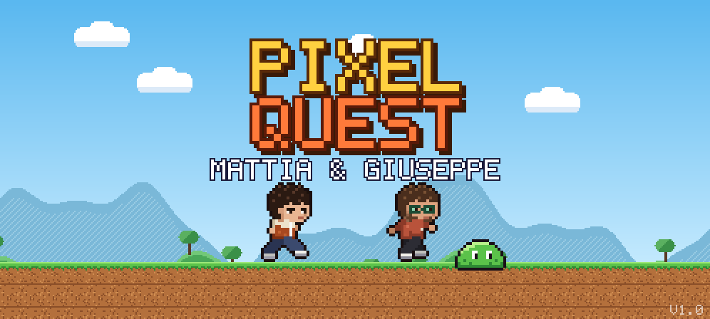
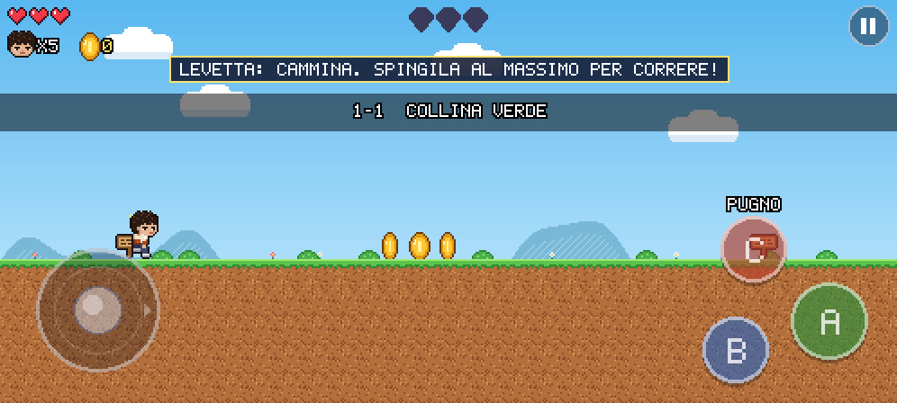

# Pixel Quest – Mattia & Giuseppe

Un platform 2D in **pixel art** per **Android**, con mappa del mondo, 4 mondi, 16 livelli e 4 boss.
I protagonisti sono **Mattia Battaglia** e **Giuseppe Mandanici**, disegnati in pixel art a partire dalle loro foto.

**APK pronto da installare:** [`release/PixelQuest.apk`](release/PixelQuest.apk)

| | |
|---|---|
|  |  |
|  |  |

## Installazione
1. Copia `release/PixelQuest.apk` sul telefono (o scaricalo da GitHub).
2. Aprilo e consenti l'installazione da "origini sconosciute" se Android lo chiede.
3. Richiede Android 7.0 o superiore. Il gioco è in orizzontale e a schermo intero.

L'APK è firmato con una chiave di debug (`keystore/pixelquest-debug.p12`): le build successive
fatte con `./build.sh` usano la stessa chiave, quindi si installano sopra la versione precedente.

## Comandi (touch)
| Comando | Azione |
|---|---|
| **Levetta** (metà sinistra dello schermo) | Cammina. **Spingila fino al bordo per correre** |
| **A** | Salta (tieni premuto per saltare più in alto) |
| **B** | Salto **spin** (distrugge anche i ricci spinosi e i proiettili) |
| **C** | Abilità del personaggio |
| ⏸ in alto a destra | Pausa (musica/effetti on/off, esci dal livello) |

Combinazioni comuni a tutti i personaggi:
- **Corsa automatica**: levetta all'estremo.
- **Wall jump**: in aria, appoggiandoti a un muro ti attacchi automaticamente e scivoli; premi **A** per rimbalzare.
- **Triplo salto con capriola**: correndo, salta 3 volte di fila appena atterri; il terzo salto è una capriola altissima.
- **Rimbalzo sui nemici**: salta sulla testa dei nemici (tieni A/B per rimbalzare più in alto).
- Sono supportati anche tastiera e gamepad (frecce/WASD, Spazio/Z = A, X = B, C = C, Invio = pausa).

## Personaggi
| | Mattia Battaglia | Giuseppe Mandanici |
|---|---|---|
| Aspetto | Capelli ricci scuri, pile ruggine e crema | Capelli ricci, occhiali verdi tondi, barba, felpa terracotta |
| Velocità | ★★★★★ | ★★★★☆ |
| Salto | ★★★☆☆ | ★★★★★ |
| Abilità (C) | **Pugno**: stende i nemici, rompe i mattoni, respinge i proiettili | **Pistola**: spara a distanza, **2 colpi ogni 10 secondi**, danno doppio ai boss |

Il personaggio si sceglie all'avvio e si può cambiare in qualsiasi momento dalla mappa (tasto C, "EROE").

## Mondi e livelli
Ogni mondo ha 3 livelli e un castello finale con un boss. Ogni livello normale nasconde **3 gemme** (48 in totale).

| Mondo | Livelli | Boss |
|---|---|---|
| 1 – Prati Pixel | Collina Verde (tutorial), Ponti sul Ruscello, Torri di Mattoni | **Re Cinghialone**: carica a testa bassa; quando sbatte contro il muro resta stordito |
| 2 – Deserto Dorato | Dune Ardenti, Rovine Antiche, Canyon dei Venti | **Faraone Scarabeo**: vola e lancia sabbia, poi si tuffa a terra |
| 3 – Picchi Ghiacciati | Pendii Innevati, Grotta di Cristallo, Vetta Gelata (scalata verticale) | **Yeti Glaciale**: palle di neve e schianti che fanno cadere stalattiti |
| 4 – Fortezza di Lava | Fiume di Magma, Fucina Oscura, Torre delle Ombre (scalata verticale) | **Lord Magmus**: si teletrasporta e lancia ventagli di fuoco |

Nemici: gelatine, ricci spinosi (si battono con lo spin, il pugno o la pistola), pipistrelli, rane, pinguini,
spiriti di fuoco, cannoni, massi schiaccianti. Oggetti: monete (100 = 1 vita), cuori, stella dell'invincibilità,
pozione vita extra, molle, piattaforme mobili e che cadono, checkpoint.


## Struttura del progetto
```
app/AndroidManifest.xml
app/src/it/pixelquest/core/   motore di gioco in Java puro (nessuna dipendenza Android)
    Game, WorldMap, Level, Player, Ents (nemici/oggetti), Bosses, Hero, HeroArt (pixel art dei personaggi),
    Art/Theme (grafica procedurale), Gfx/Font (renderer software), Audio/Sfx/Music (sintetizzatore chiptune)
app/src/it/pixelquest/game/   parte Android: MainActivity, GameView (SurfaceView, touch, AudioTrack)
levels/levels.txt             i livelli in formato testo (convertiti in Levels.java da tools/genlevels.py)
desktop/                      strumenti di test: simulatore headless con screenshot, bot che verifica i livelli
tools/                        apkbuild.py (manifest binario + resources.arsc), ApkSign.java (firma v2)
```

Tutta la grafica è disegnata in un framebuffer a bassa risoluzione (altezza 224 px) e scalata con
nearest-neighbour, quindi i pixel restano nitidi su ogni schermo. La musica e gli effetti sono sintetizzati
al volo (nessun file audio).

## Compilare
Serve solo **JDK 17+**, **python3** e **curl** (non serve l'Android SDK né Gradle):
```bash
./build.sh            # -> release/PixelQuest.apk
```
Lo script scarica (una volta, con verifica SHA-256) da Maven Central: `android-all` di Robolectric (API 34)
per compilare, `dalvik-dx` per generare il `classes.dex` e `apksig` per la firma APK v2.

### Test sul computer
```bash
# screenshot dei menu e dei livelli, test delle mosse, bot di completabilità, fuzzing
javac -d /tmp/pq app/src/it/pixelquest/core/*.java desktop/src/it/pixelquest/core/*.java desktop/src/it/pixelquest/desktop/*.java
java -cp /tmp/pq it.pixelquest.desktop.Sim /tmp/shots screens
java -cp /tmp/pq it.pixelquest.desktop.Sim /tmp/shots bot      # verifica che ogni livello sia completabile
java -cp /tmp/pq it.pixelquest.desktop.Sim /tmp/shots fuzz 4000
```
Il bot esplora ogni livello con la vera fisica del gioco (corse, salti, wall jump, tripli salti, piattaforme)
e conferma che tutti i 16 livelli sono completabili con entrambi i personaggi.
