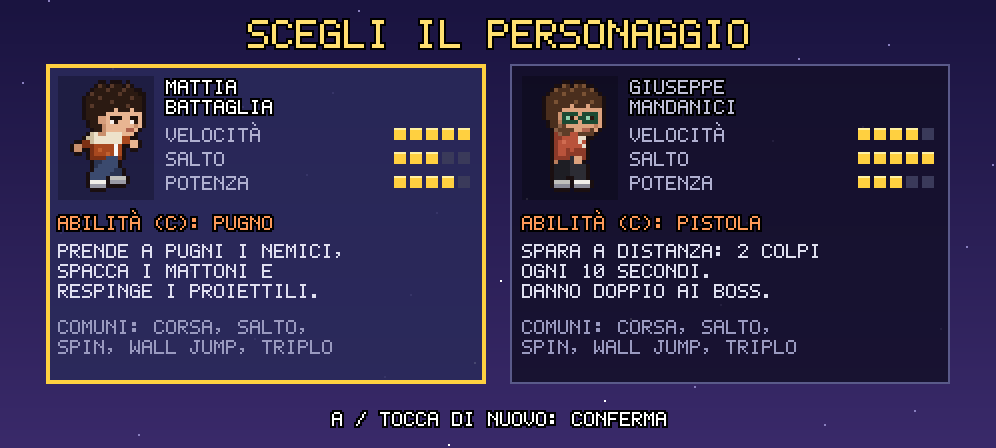
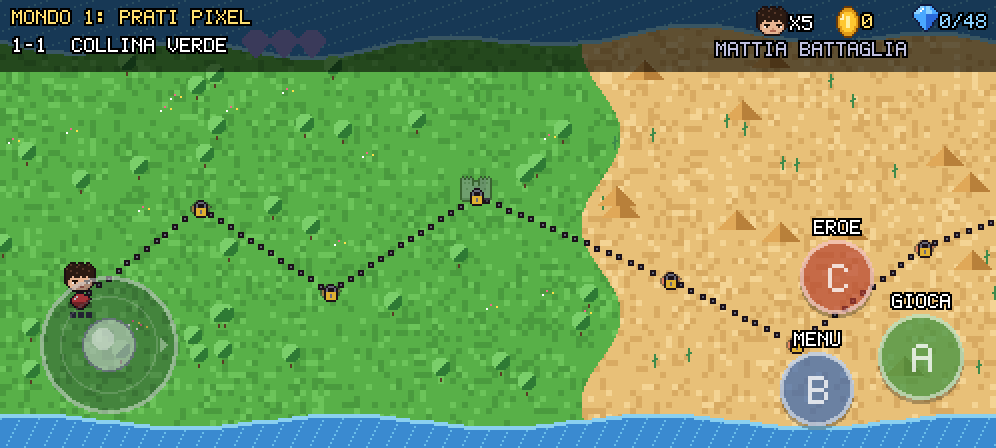
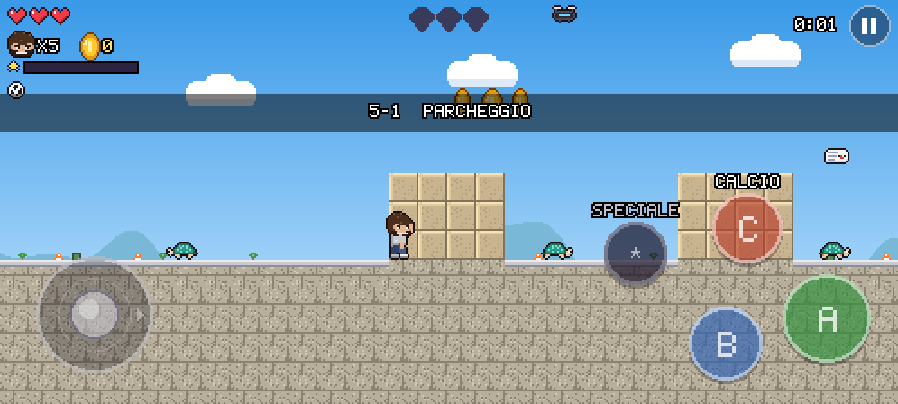
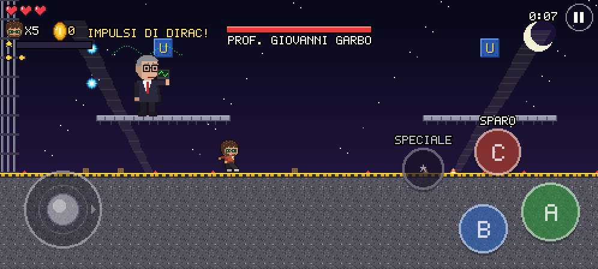
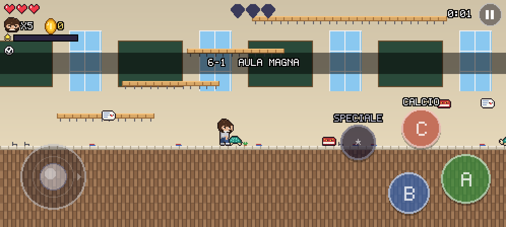
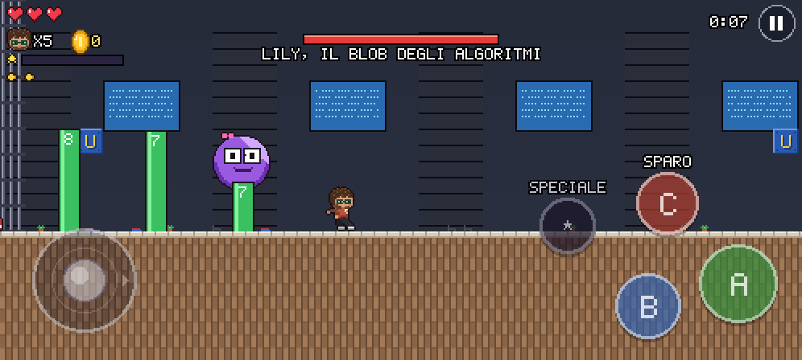
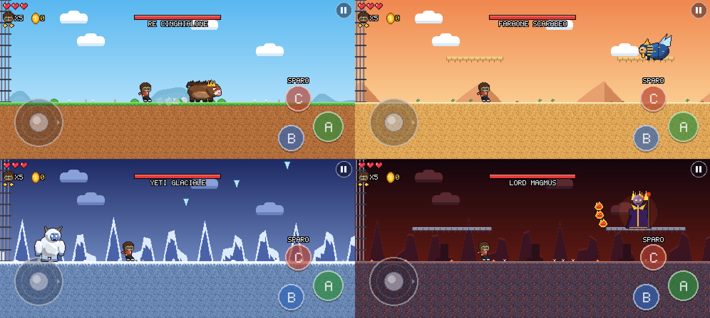
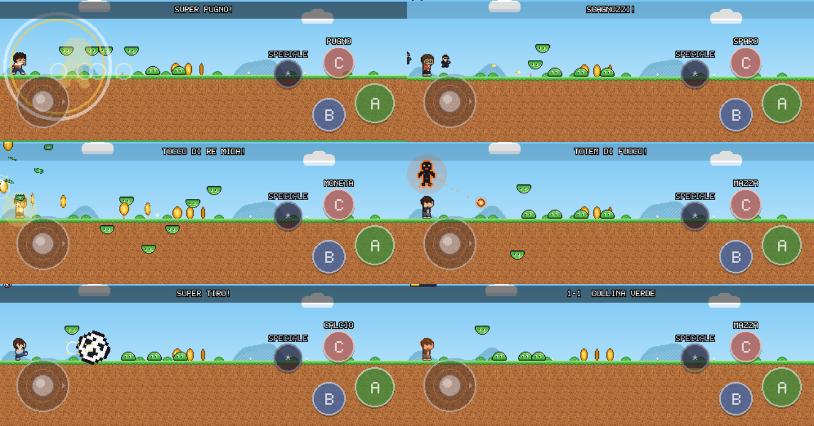
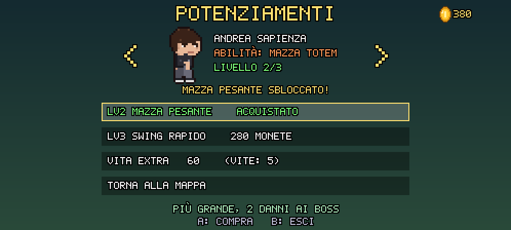

# Pixel Quest – Mattia & Giuseppe

Un platform 2D in **pixel art** per **Android**, con mappa del mondo, **7 mondi, 34 livelli e 10 boss**.
I primi 4 mondi sono il prologo. Poi comincia il **vero gioco**: 3 mondi all'**Università di Palermo (Unipa)**,
dove ad aspettarti all'uscita c'è il **Prof. Giovanni Garbo** di Teoria dei Segnali.
Ci sono 5 personaggi giocabili, disegnati in pixel art a partire dalle loro foto: **Mattia Battaglia**, **Giuseppe Mandanici**,
**Francesco Inzerillo**, **Andrea Sapienza** e **Paolo Zingales**.

**APK pronto da installare:** [`release/PixelQuest.apk`](release/PixelQuest.apk)

| | |
|---|---|
|  |  |
|  |  |
|  |  |

## Installazione
1. Copia `release/PixelQuest.apk` sul telefono (o scaricalo da GitHub).
2. Aprilo e consenti l'installazione da "origini sconosciute" se Android lo chiede.
3. Richiede Android 7.0 o superiore. Il gioco è in orizzontale e a schermo intero.

L'APK è firmato con una chiave di debug (`keystore/pixelquest-debug.p12`): le build successive
fatte con `./build.sh` usano la stessa chiave, quindi si installano sopra la versione precedente.

## Comandi (touch)
| Comando | Azione |
|---|---|
| **Levetta** (metà sinistra dello schermo) | Cammina. **Spingila verso il bordo per correre** |
| oppure **Frecce ◀ ▶** (si sceglie nel menu) | Tieni premuto per camminare; dopo un attimo il personaggio corre da solo |
| **A** | Salta (tieni premuto per saltare più in alto) |
| **B** | Salto **spin** (distrugge anche i ricci spinosi e i proiettili) |
| **C** | Abilità del personaggio (oppure **calcia il guscio** di tartaruga che stai portando) |
| **★ SPECIALE** | Mossa speciale, quando la barra dell'energia è piena |
| ⏸ in alto a destra | Pausa |

Reattività dei comandi:
- **Tasti A/B/C:** tutta la parte destra dello schermo è divisa tra i tre tasti (vince il più vicino), quindi un tocco
  verso il bordo o nell'angolo viene comunque preso. Anche un tocco brevissimo viene registrato e fa un salto vero.
- **Levetta:** se tocchi il pad il personaggio parte subito. Se tocchi altrove a sinistra il pad si sposta sotto il dito.
  Il pad segue il dito, quindi per invertire la direzione basta un piccolo movimento.
- **Vibrazione:** una breve vibrazione conferma ogni pressione (si può disattivare). Non rallenta mai il tocco
  successivo, perché gira su un thread a parte.
- **Bordi dello schermo:** con la navigazione a gesti, Android tratteneva i tocchi vicino al bordo (il gesto "indietro")
  e il tasto A a volte arrivava in ritardo. Ora la parte bassa dei due bordi è esclusa dai gesti.
- **Pollice tra due tasti / tra le due frecce:** il tasto o la freccia tenuti restano quelli finché il dito non è
  chiaramente sull'altro, quindi niente salti interrotti né corsa che si azzera.

**Opzioni** (tasto B "MENU" sulla mappa, oppure ⏸ durante il livello): COMANDI levetta/frecce, VIBRAZIONE,
MUSICA, EFFETTI, cambio personaggio.

Combinazioni comuni a tutti i personaggi:
- **Corsa automatica**: levetta all'estremo (o freccia tenuta premuta).
- **Wall jump**: in aria, appoggiandoti a un muro ti attacchi automaticamente e scivoli; premi **A** per rimbalzare.
- **Triplo salto con capriola**: correndo, salta 3 volte di fila appena atterri; il terzo salto è una capriola altissima.
- **Rimbalzo sui nemici**: salta sulla testa dei nemici (tieni A/B per rimbalzare più in alto).
- Sono supportati anche tastiera e gamepad (frecce/WASD, Spazio/Z = A, X = B, C = C, Invio = pausa).

## Personaggi
| Personaggio | Abilità (C) | Mossa speciale (★) |
|---|---|---|
| **Mattia Battaglia**: ricci scuri, pile ruggine e crema | **Pugno**: stende i nemici, spacca i mattoni, respinge i proiettili | **Super pugno**: onda d'urto enorme davanti a lui (danno 5 a tutti, 4 ai boss) |
| **Giuseppe Mandanici**: occhiali verdi, barba, felpa terracotta | **Pistola**: 2 colpi ogni 10 secondi, danno 2 | **Scagnozzi**: due scagnozzi sparano ai nemici per 5,5 secondi |
| **Francesco Inzerillo**: ricci neri, apparecchio, maglia crema | **Moneta d'oro**: un'esplosione di **banconote taglienti** colpisce tutti i nemici vicini (circa 3 blocchi davanti e 2 dietro, 1 danno, distrugge anche i proiettili), poi una moneta rimbalza 3 volte e colpisce chi incontra (ogni 2,5 s) | **Tocco di Re Mida**: diventa d'oro con la corona e una fontana di monete colpisce tutto per 3 s; ogni nemico colpito dà una moneta |
| **Andrea Sapienza**: frangia scura, maglia nera | **Mazza totem** (nera, a forma di persona): swing ogni secondo che rispedisce indietro palle di cannone e proiettili e scaglia via i nemici, che diventano proiettili | **Totem di fuoco**: il totem gigante appare sopra di lui e lancia palle di fuoco per 4,5 s |
| **Paolo Zingales**: ciuffo, barba folta, maglia grigia | **Pallone**: calcio con 3 grandi rimbalzi, danno 2 (si ricarica in 2,5 s) | **Super tiro**: un pallone gigante va dritto e travolge nemici e mattoni (5 ai boss) |

Tutti hanno in comune corsa, salto variabile, spin, wall jump e triplo salto con capriola. Il personaggio si sceglie
all'avvio e si cambia dalla mappa (tasto C "EROE" o dal menu).

### Energia e mosse speciali
La barra ★ in alto si riempie sconfiggendo nemici (+12, golem +25), raccogliendo monete (+1) e gemme (+20) e colpendo
i boss (+8). Quando è piena il tasto **SPECIALE** lampeggia. Morendo si conserva metà dell'energia.

### Power-up
Nei blocchi ci sono **fiori di fuoco** e **fiori di ghiaccio**. Come i cuori, escono dal blocco e camminano
(nella direzione in cui guarda il personaggio), quindi si prendono senza salire sul blocco:
- **Fuoco**: l'abilità diventa infuocata (+1 danno; il pugno e la mazza lanciano anche una palla di fuoco).
- **Ghiaccio**: l'abilità congela i nemici, che diventano blocchi di ghiaccio innocui da frantumare; i boss vengono rallentati.

Se vieni colpito perdi il fiore invece di un cuore. Ci sono anche cuori, stella dell'invincibilità e pozione vita extra.

### Negozio (potenziamenti con le monete)
Dalla mappa: **B MENU, poi POTENZIAMENTI**. Le monete restano tue e si spendono qui; ogni 100 monete raccolte ricevi
comunque una vita.
| | Livello 2 (120 monete) | Livello 3 (280 monete) |
|---|---|---|
| Mattia | Doppio pugno (due pugni di fila) | Pugno rapido e più lungo |
| Giuseppe | 3 colpi ogni 10 s | 4 colpi ogni 10 s |
| Francesco | 2 monete pronte | Ricarica in 1,7 s, più banconote e più lontano |
| Andrea | Mazza pesante: più grande, 2 danni ai boss | Swing ogni 0,6 s |
| Paolo | 2 palloni pronti | Tiro potente: 5 rimbalzi, più veloce |

Si può comprare anche una **vita extra** (60 monete).

### Grado di superamento
Alla fine di ogni livello compare il riepilogo: tempo, danni subiti, cadute, nemici, monete e gemme. Il grado va da **S** a **D**:
- **S**: livello finito entro il tempo indicato, senza subire danni e senza cadute.
- **A / B / C / D**: si perdono punti per il tempo in più, per ogni danno (−12) e per ogni caduta (−20); ogni gemma vale +3.

## Mondi e livelli
Ogni livello normale nasconde **3 gemme** (72 in totale). Il miglior grado di ogni livello appare sulla mappa.

### Prologo (mondi 1-4)
Ogni mondo ha 3 livelli e un castello finale con un boss.

| Mondo | Livelli | Boss |
|---|---|---|
| 1 – Prati Pixel | Collina Verde (tutorial), Ponti sul Ruscello, Torri di Mattoni | **Re Cinghialone**: carica a testa bassa; quando sbatte contro il muro resta stordito |
| 2 – Deserto Dorato | Dune Ardenti, Rovine Antiche, Canyon dei Venti | **Faraone Scarabeo**: vola e lancia sabbia, poi si tuffa a terra |
| 3 – Picchi Ghiacciati | Pendii Innevati, Grotta di Cristallo, Vetta Gelata (scalata verticale) | **Yeti Glaciale**: palle di neve e schianti che fanno cadere stalattiti |
| 4 – Fortezza di Lava | Fiume di Magma, Fucina Oscura, Torre delle Ombre (scalata verticale) | **Lord Magmus**: si teletrasporta e lancia ventagli di fuoco |

Nemici: gelatine, ricci spinosi (si battono con lo spin o con le abilità), pipistrelli, rane, pinguini,
spiriti di fuoco, cannoni, massi schiaccianti, **golem di pietra** (3 colpi), **cactus sparaspine** e **lucertole** che
scattano verso di te. I nemici sono più veloci nei mondi avanzati e i boss hanno più vita. Oggetti: monete (100 = 1 vita), cuori, stella dell'invincibilità,
pozione vita extra, molle, piattaforme mobili e che cadono, checkpoint.

### Il vero gioco: Unipa (mondi 5-7)
Dopo aver sconfitto Lord Magmus parte la **storia**: il prologo era solo l'inizio, ora bisogna laurearsi.
I mondi di Unipa sono strutturati diversamente: **2 livelli, castello del boss intermedio, 2 livelli,
castello del boss di fine mondo**. Sono molto più difficili del prologo.

| Mondo | Livelli | Boss intermedio | Boss di fine mondo |
|---|---|---|---|
| 5 – **Primo anno** (fuori da Unipa, che si avvicina livello dopo livello sullo sfondo) | Parcheggio, Viale delle Scienze, La Scalinata (verticale), Il Cortile | **Martino** (Ingresso di Unipa): *libri in testa*, scatti, *pioggia di libri* | **Angela Valenti** (Atrio di Unipa): ventagli di gessetti, *interrogazione* (pioggia di punti interrogativi), teletrasporto e fogli d'esame volanti |
| 6 – **Secondo anno** (dentro le aule) | Aula Magna, Laboratorio di Fisica, La Biblioteca (verticale), Sala Server | **Principato**, il vecchio professore di fisica scorbutico (Aula di Fisica): *vettori*, *pendolo semplice*, *gravità raddoppiata* con mele che cadono, schianti | **Lily, il blob degli algoritmi** (Aula di Informatica): *ricerca binaria*, *ordinamento* (colonne che spuntano dal pavimento), *ciclo infinito*, *ricorsione* (si divide in gelatine) |
| 7 – **Ultimo anno** (la fuga da Unipa, di notte) | Corridoi di Notte, Segreteria, I Tetti di Unipa, **La Grande Fuga** (lo schermo scorre da solo!) | **Luca Cruciata** (Terrazza di Unipa): *scatti*, *frisbee* a boomerang, onde del *megafono* | **Prof. Giovanni Garbo** (L'Uscita di Unipa): *segnali aleatori*, *sinusoidi*, *impulsi di Dirac*, *onda quadra*, fantasmi della *trasformata di Fourier*, teletrasporto |

Battendo Garbo si esce da Unipa... **con la laurea**, con tanto di tocco in testa nel finale.

**Tartarughe e gusci**: salta su una tartaruga e si ritira nel guscio. Toccalo camminando per **raccoglierlo**,
poi premi **C** per **calciarlo**: scivola veloce, rimbalza contro i muri, rompe i mattoni e travolge nemici e
proiettili (3 danni anche ai boss). Attento: dopo il primo rimbalzo il guscio fa male anche a te (saltaci sopra per
fermarlo). Se lo porti addosso contro un nemico lo colpisci; se ti colpiscono lo perdi. Lasciato fermo per 8 secondi,
la tartaruga torna fuori.

Nuovi nemici: **fogli d'esame** volanti che scendono a onde, **libri** che mordono (2 colpi), **distributori
automatici** (4 colpi) che sparano lattine rimbalzanti, **droni** di sicurezza che sganciano bombe,
**laser** dal soffitto (lampeggiano prima di sparare) e **atomi** con elettroni che ruotano.
Nuovi blocchi: **nastri trasportatori**, **blocchi A/B** che appaiono e scompaiono a tempo (ti spingono fuori se ti
trovi dentro) e i **blocchi U** di Unipa.

| Secondo anno | Lily |
|---|---|
|  |  |



| Mosse speciali | Negozio |
|---|---|
|  |  |

## Struttura del progetto
```
app/AndroidManifest.xml
app/src/it/pixelquest/core/   motore di gioco in Java puro (nessuna dipendenza Android)
    Game, WorldMap, Level, Player, Ents (nemici/oggetti), Bosses, Hero, HeroArt (pixel art dei personaggi),
    Uni/UniBosses/UniArt (nemici, gusci, boss e grafica dei mondi di Unipa),
    Art/Theme (grafica procedurale), Gfx/Font (renderer software), Audio/Sfx/Music (sintetizzatore chiptune)
app/src/it/pixelquest/game/   parte Android: MainActivity, GameView (SurfaceView, touch, AudioTrack)
levels/levels.txt             i livelli in formato testo (convertiti in Levels.java da tools/genlevels.py)
desktop/                      strumenti di test: simulatore headless con screenshot, bot che verifica i livelli
tools/                        apkbuild.py (manifest binario + resources.arsc), ApkSign.java (firma v2)
```

Tutta la grafica è disegnata in un framebuffer a bassa risoluzione (altezza 224 px) e scalata con
nearest-neighbour, quindi i pixel restano nitidi su ogni schermo. La musica e gli effetti sono sintetizzati
al volo (nessun file audio).

## Compilare
Serve solo **JDK 17+**, **python3** e **curl** (non serve l'Android SDK né Gradle):
```bash
./build.sh            # -> release/PixelQuest.apk
```
Lo script scarica (una volta, con verifica SHA-256) da Maven Central: `android-all` di Robolectric (API 34)
per compilare, `dalvik-dx` per generare il `classes.dex` e `apksig` per la firma APK v2.

### Test sul computer
```bash
# screenshot dei menu e dei livelli, test delle mosse, bot di completabilità, fuzzing
javac -d /tmp/pq app/src/it/pixelquest/core/*.java desktop/src/it/pixelquest/core/*.java desktop/src/it/pixelquest/desktop/*.java
java -cp /tmp/pq it.pixelquest.desktop.Sim /tmp/shots screens
java -cp /tmp/pq it.pixelquest.desktop.Sim /tmp/shots bot      # verifica che ogni livello sia completabile
java -cp /tmp/pq it.pixelquest.desktop.Sim /tmp/shots fuzz 4000
java -cp /tmp/pq it.pixelquest.desktop.Sim /tmp/shots controls  # test di reattività dei comandi touch
```
Il bot esplora ogni livello con la vera fisica del gioco (corse, salti, wall jump, tripli salti, piattaforme, molle,
blocchi A/B a tempo) e verifica che si possa arrivare al traguardo e prendere le gemme, anche con i personaggi che
saltano meno (Mattia) e corrono più piano (Andrea). Non dice niente sulla difficoltà: quella va provata a mano.
```bash
java -DbotFrom=16 -DbotHero=3 -DbotHeroes=5 -cp /tmp/pq it.pixelquest.desktop.Sim /tmp/shots bot   # Unipa con Andrea
java -cp /tmp/pq it.pixelquest.desktop.Sim /tmp/shots maptest   # la mappa avanza di un nodo a ogni pressione
java -cp /tmp/pq it.pixelquest.desktop.Sim /tmp/shots cash      # banconote di Francesco contro il pallone di Paolo
```
